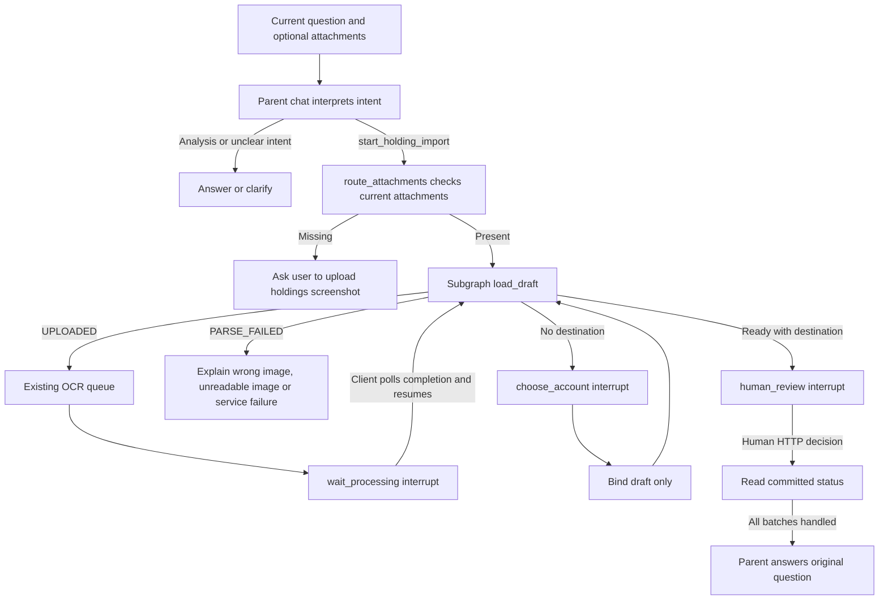

# Agent screenshot holdings sync: backend and mobile

Images accompany the user's question. Mobile keeps selected images locally, stages them on Send, and submits the question with server-issued import IDs. Staging creates UPLOADED drafts without OCR or holdings writes. The parent's ordinary chat-model call first interprets the current user request. Explicit image-import intent selects the parameterless start_holding_import tool; the router then checks current-turn attachments before entering the subgraph. Uploading an image alone, analysis, diagnosis and explicit refusal do not authorize import. Ambiguous intent requires clarification. The web frontend is outside this phase.

## Workflow

Recognition reuses Taskiq and local OCR. Redis requires the screenshot worker; development can use the existing in-process broker. The subgraph adds no chat-model calls. Checkpoints and interrupts avoid keeping an HTTP connection open. Mobile resumes after polling completion; the backend does not push to offline clients.

Intent detection uses the existing parent chat call, without a separate classifier request. Recognition and account/review pauses do not poll the chat model. The parent resumes its answer after completion. Missing images and failed recognition produce deterministic guidance without another model call. OCR content checks distinguish clearly unrelated images, unreadable text and incomplete holdings lists; they are heuristic checks, not a universal image classifier. Valid images in a partially failed batch remain available, with a visible warning on the review card. Only human confirmation updates holdings.

An explicit holding_account_id or unambiguous owned account name in the original instruction skips the destination question. Missing, ambiguous or negated destinations require selection, even when only one account exists. Image text, old history and the first account are not defaults.

## Contract

Paths are relative to /api/v1 and require the current chat session access token.

| Action | Endpoint | Contract |
| --- | --- | --- |
| Stage | POST /chatbot/holding-imports/screenshots | multipart files; optional query account_id; 202 with import_id and UPLOADED |
| Submit | POST /chatbot/chat or /chatbot/chat/stream | messages, holding_import_ids, optional holding_account_id |
| Progress | GET /chatbot/holding-imports/{id} | status and full draft |
| Recovery | GET /chatbot/pending-action | pending action or null |
| Continue | POST /chatbot/holding-imports/{id}/continue | interrupt_id |
| Destination | POST /chatbot/holding-imports/{id}/account | interrupt_id, account_id; draft only |
| Decision | POST /chatbot/holding-imports/{id}/decision | interrupt_id, decision; confirmation requires review_digest |

IDs must come from actual uploads. Ownership and session binding are checked. Images are not sent to the parent model as URLs/base64. Existing format, count and size validation applies.

Pending actions are discriminated by kind:

- holding_import_processing: mobile polls every three seconds and automatically continues when recognition ends. Continuing unfinished OCR returns 409.
- holding_import_account: lists owned accounts; buttons or an ordinary account-name reply select a destination without writing holdings. Create an account first if none exist.
- holding_import_review: contains destination ID/name, all items, actual interrupt ID and digest. Only the authenticated human decision endpoint applies holdings; chat confirmation cannot approve.

Cards appear in chat/history responses and the final stream frame. Checkpoints preserve them across reconnection. Mobile state and query keys are session-scoped. Ordinary chat is blocked during processing/review, while destination selection accepts an account reply.

## Consistency and recovery

Mobile review scrolls through all rows, displaying amounts, shares, confidence, issues and existing position amounts. The chat card provides viewing, confirmation and cancellation. Existing item PATCH supports corrections; refresh to obtain a new digest after editing. An old digest returns 409 without writes.

Confirmation overwrites adopted fields for matched funds, preserving holdings absent from the screenshot. Positions, IMPORT_ADJUSTMENT audit entries and APPLIED status commit together. Repeated confirmation is idempotent. Only APPLIED indicates success.

Cancellation is available during processing, selection and review. OCR locks and rechecks status before saving; late success or failure cannot resurrect a cancelled draft. Multiple batches are reviewed sequentially before the parent resumes, with paired ToolCall/ToolMessage records.

Batch locks prevent duplicate OCR enqueueing. Continue, account replies and decisions share a session lock; concurrent resumes return 409. Multi-worker deployments require available Valkey/Redis; memory locking is for a single process. After a failure or timeout, check batch status and pending action before retrying; committed imports are not applied twice.

Attachments whose question was never submitted remain UPLOADED and do not run OCR. Existing cancellation can clean them up; this phase adds no periodic abandoned-file cleanup job.

## Migration and verification

Migration f1a6c8b4d209 allows unassigned session screenshot drafts. A database check still requires destinations for ordinary imports and APPLIED batches. Run APP_ENV=<environment> alembic upgrade head in other environments, then restart the backend.

Entry: backend/app/agent/graph/agent.py (route_attachments). Subgraph: backend/app/agent/graph/holding_import.py. Mobile: mobile/app/(tabs)/agent.tsx. Client types are generated from backend OpenAPI.

Tests cover real graph interruption/recovery, explicit/missing accounts, chat replies, ownership/session isolation, stale interrupts, concurrent/repeated requests, OCR failure, cancellation during recognition and sequential batches. PostgreSQL rollback tests verify unassigned persistence, destination binding and confirmation. Automated checks do not use real user screenshots or call real chat models.
