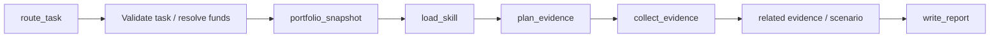

# Research workflows and mobile data cards

The implementation retains the project layers: graph orchestration in `app/agent/graph`, contracts in `app/schemas`, pure financial calculations in `app/analytics`, domain services and async repositories, and mobile adapters in `mobile/components` / `mobile/hooks`. No new database table or migration is required.

## Flow

`route_task` has a conservative, model-free route for explicit fund codes, prefixed stock symbols, BK sector identifiers and unambiguous portfolio diagnosis. Other language uses the existing chat model to propose `start_research`; no separate classifier/planner model is added. Request identifiers must be present in the current user message or, for funds, already confirmed in the same turn. Account IDs cannot be guessed from names. A position value/cost is not automatically a proposed operation amount.

Fund requests first use existing Top3 selection and resume the original task. Stocks require an explicit market prefix (`sh600519`, `sz000001`, `hk00700`, `usAAPL`); name-only stock resolution is not implemented. Sector names matching multiple real sectors return up to three candidates and ask for a code before a definitive report.



Every research child starts with a read-only portfolio snapshot. This is not screenshot import and never requests an image or creates holdings. Empty books are distinct from failed reads; public fund, stock and sector research does not require ownership. Personal evidence only enters the report when requested by the task. User identity comes from authenticated runtime metadata. The snapshot uses batched fund/NAV reads and the ledger projection, preserves all rows for computation, and sorts by saved position value. A read timestamp does not prove that saved position values were refreshed at that time.

| Task | Skill |
| --- | --- |
| fund_research | fund-analysis |
| portfolio_diagnosis | portfolio-diagnosis |
| allocation_analysis | fund-allocation |
| sector_research | sector-analysis |
| stock_research | stock-analysis |

Skills load before planning evidence. Plans are bounded, code-generated and read-only, with up to four concurrent tools and a 25-second deadline per query. Standard fund research gathers profile, analytics, holdings and managers; deep mode adds disclosures. Portfolio diagnosis studies up to three distinct priority funds. Market/sector/events are conditional evidence, not extra LLM planning rounds. Event IDs and BK identifiers come from actual tool results. Final synthesis is one unbound model call with persona, memory and Langfuse integration retained; language routing, compaction and provider fallback may still add model calls.

Private child state contains the snapshot, loaded skill, tool plan, evidence and scenario. The parent receives only the final message and compact ResearchResult. Evidence is budgeted to 6,500 tokens; long bodies and position display above 50 rows have explicit gaps. Scenario calculations always use the complete snapshot and require matching summary totals and known, finite position values. Build/increase assumes new funds enter the fund-assets bucket; reduce/exit assumes money leaves it. Cash, other assets, fees, conversions and future performance are not modeled. Missing amount permits conditional analysis, without fabricated weights. These APIs never execute trades.

Stock research concurrently reuses quotation, one-year adjusted daily history and company-profile services. Only calculated price metrics, bounded company text and a chart identifier go to the model; OHLC arrays do not. Source failures remain explicit and do not erase successful evidence. Mainland quote freshness is checked; overseas freshness/timezones are not claimed as verified. Complete financial statements, direct stock holdings, corporate disclosures, earnings forecasts and target prices are outside current coverage. Sector coverage currently supplies quotes, not sector historical OHLC, fund flows or industry valuations.

## Human input and failed-run continuation

Fund selection resumes the original research task. If the chat model called `resolve_fund_for_analysis` directly, a clear research instruction is converted to a task using the actual confirmed tool results. Confirmed objects from the current turn are reused; simple NAV/manager questions stay in chat. Selection does not start another planning or search round.

General `ask_human` pauses are exposed as `pending_action.kind = human_question`, including the question and real interrupt ID. They survive history reloads and accept a normal text reply, which resumes the same interrupt. LangGraph implements this pause through `GraphInterrupt`; a trace showing `Interrupt(value=...)` at the tool is an expected wait, not evidence of a failed model call. Do not swallow this exception or automatically answer it.

When a later node fails after confirmation, `GET /chatbot/pending-action` returns a separate `continuation` with the original turn ID. The mobile continuation button calls `POST /chatbot/continue` with that ID. An explicit “继续分析” or “重试” message also continues a pending failed run. Execution resumes checkpointed nodes without resending the decision, resetting the target or repeating already checkpointed evidence. This does not guarantee exactly-once behavior for an external side effect that completed before its node checkpoint was saved. A current human interruption or a different turn is rejected with 409; a completed run is returned without executing it again. A new substantive question still starts a new turn.

Chat and decision requests share a per-session execution lock. Mobile decision callbacks and cache invalidations stay attached to their origin session; switching sessions cannot attach the old result to the newly visible conversation. Successful terminal streaming frames explicitly clear the old pending action.

## Mobile references

Existing `fund-chart` and `fund-holdings` continue through their existing components. New references use a complete top-level `research-chart` JSON fence:

```json
{"schema_version":1,"type":"stock_price","symbol":"sh600519"}
```

```json
{"schema_version":1,"type":"sector_quote","sector_code":"BK1234","sector_type":"industry"}
```

```json
{"schema_version":1,"type":"fund_allocation","fund_code":"000001","account_id":null,"action":"increase","amount":200}
```

The code issues these references from verified evidence/scenarios. Final report validation removes model-altered references and appends missing authorized ones. Streaming prose is preserved, while new reference fences and their suffix wait for final validation. The final streamed text matches persisted history. The mobile parser rejects partial fences, unknown versions, extra fields, URL/script/series payloads, invalid identifiers and invalid numbers.

- Stock cards reuse the unchanged `MarketChart` and existing `/markets/{symbol}/quote` / `/history` hooks, with 1/3/6/12-month range controls.
- Sector cards read authenticated `GET /sectors/market` using a real BK identifier/type. Quote date, missing values and source warnings are visible. A history slot states that historical data is not connected; no synthetic line is drawn.
- Allocation cards read authenticated `GET /portfolio/allocation-preview`, recalculate against the current user's book and show before/after fund weights. Query keys include user, fund, account, action and amount; portfolio changes invalidate the shared prefix. The endpoint validates account ownership and contains no write operation.

Cards may fetch later data than the report; they display that distinction. Existing fund detail, NAV and market chart components are reused without behavior changes. Automated tests mock external providers and models; actual-provider report quality, latency and native-device interaction still require live verification.
