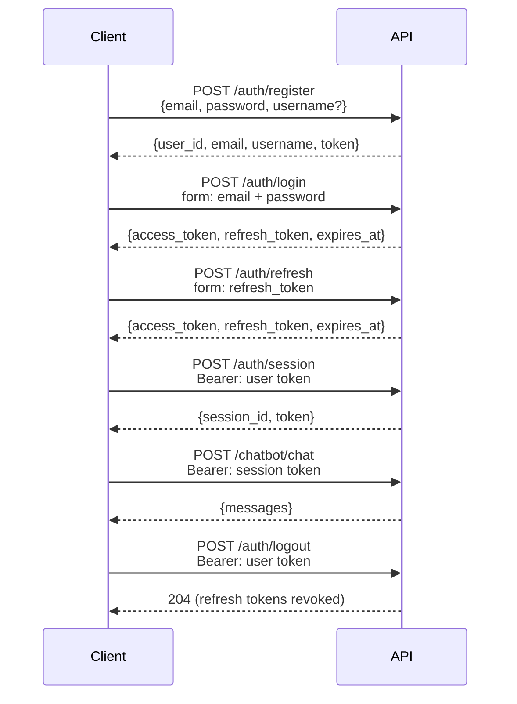

# Authentication

## Flow



The API uses **two token scopes**:

- **User token** — issued on register/login, identifies the user. Used to create and list sessions, and for every protected business endpoint (`/funds`, `/watchlist`, `/portfolio`, `/holding-imports`, …).
- **Session token** — issued per conversation session. Required for all chat endpoints. Scoped to a single `session_id`.

Both carry `typ: "access"` and are the only tokens the auth dependencies accept. **Refresh tokens carry `typ: "refresh"` and are rejected everywhere else** — they can only be exchanged at `POST /auth/refresh`.

Access tokens are short-lived (`JWT_ACCESS_TOKEN_EXPIRE_DAYS`, default 1 day); refresh tokens live `JWT_REFRESH_TOKEN_EXPIRE_DAYS` (default 90 days). They are stateless, so logout cannot kill an access token in flight — it revokes refresh tokens instead (see `/auth/logout`).

---

## Endpoints

### `POST /api/v1/auth/register`

Create a new account.

```json
{
  "email": "you@example.com",
  "password": "Secret123!",  // pragma: allowlist secret
  "username": "you"
}
```

Password requirements: 8+ chars, uppercase, lowercase, number, special character.

`username` is optional. When provided, it's passed to the agent's system prompt so the LLM knows the user's name.

---

### `POST /api/v1/auth/login`

Exchange credentials for a user token. Uses OAuth2 password grant form fields.

```bash
curl -X POST /api/v1/auth/login \
  -F "email=you@example.com" \
  -F "password=Secret123!" \
  -F "grant_type=password"
```

Returns `access_token`, `refresh_token` and `expires_at`.

---

### `POST /api/v1/auth/refresh`

Exchange a refresh token (`typ: "refresh"`) for a fresh access token and a rotated refresh token. Form-encoded body.

```bash
curl -X POST /api/v1/auth/refresh \
  -F "refresh_token=<refresh token>"
```

Returns 401 when the token is malformed, expired, not a refresh token, or was revoked by a logout.

---

### `POST /api/v1/auth/logout`

Revokes the caller's refresh tokens: any refresh token issued before this call is rejected from then on. Requires a user token. Returns `204` with no body. Access tokens stay valid until their own expiry.

---

### `GET /api/v1/auth/me`

Returns the authenticated user's profile (`id`, `email`, `username`, `created_at`). Requires a user or session token.

---

### `POST /api/v1/auth/session`

Create a new chat session. Requires a valid user token.

```bash
curl -X POST /api/v1/auth/session \
  -H "Authorization: Bearer <user token>"
```

Returns `session_id` and a session-scoped `token`. Use this session token for all subsequent chat requests.

---

### `PATCH /api/v1/auth/session/{session_id}/name`

Rename a session.

```bash
curl -X PATCH /api/v1/auth/session/{session_id}/name \
  -H "Authorization: Bearer <session token>" \
  -F "name=My research session"
```

---

### `DELETE /api/v1/auth/session/{session_id}`

Delete a session and its chat history.

---

### `GET /api/v1/auth/sessions`

List all sessions for the authenticated user. Requires a user token.

---

## Security notes

- Passwords are hashed with bcrypt before storage — plaintext is never persisted.
- JWTs include a `jti` (JWT ID) claim for token uniqueness.
- All string inputs are sanitised before use.
- Rate limits protect the register (10/hour) and login (20/min) endpoints against brute force.
- Set a long random `JWT_SECRET_KEY` in production — at least 32 characters.
