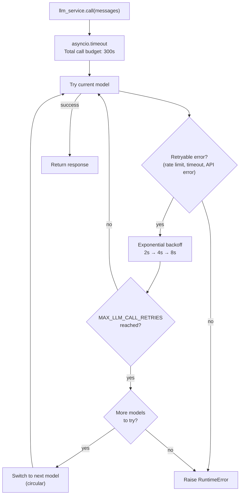

# LLM Service

## Overview

The LLM service (`app/services/llm/`) handles all language model calls with automatic retries, circular model fallback, and a total timeout budget. Your agent code calls `llm_service.call(messages)` — the service handles everything else.

The package includes these modules:

- `app/services/llm/registry.py` — `LLMRegistry`: defines available models
- `app/services/llm/service.py` — `LLMService`: call logic, retries, fallback, structured output
- `app/services/llm/timeouts.py` — per-call stream progress and timeout classification

## Model registry

Models are defined in `LLMRegistry.LLMS` in order of preference:

| Name           | Model        | Notes                                  |
| -------------- | ------------ | -------------------------------------- |
| `gpt-5-mini`   | gpt-5-mini   | Default. Low reasoning effort.         |
| `gpt-5.4`      | gpt-5        | Medium reasoning effort.               |
| `gpt-5.4-nano` | gpt-5.4-nano | Fast, low reasoning effort.            |
| `gpt-5`        | gpt-5        | Full model, production-tuned sampling. |

Set `DEFAULT_LLM_MODEL` in your `.env` to choose the starting model.

To add or change models, edit `LLMRegistry.LLMS` in `app/services/llm/registry.py`.

## Retry and fallback behaviour



**Retry config** (per model):

- Max attempts: `MAX_LLM_CALL_RETRIES` (default: 3)
- Wait: exponential backoff, 2s min, 10s max
- Retries on: `RateLimitError`, `APITimeoutError`, `APIError`

**Timeouts** apply to each `llm_service.call`, including its retries and fallback, rather than the entire multi-step Agent run:

| Environment variable | Default | Behaviour |
| --- | --- | --- |
| `FUND_LLM_TIMEOUT_SECONDS` | `120` | Wait for initial progress; also the HTTP request timeout. `FUND_LLM_REQUEST_TIMEOUT_SECONDS` overrides it. |
| `FUND_LLM_STREAM_IDLE_TIMEOUT_SECONDS` | `60` | Maximum gap after meaningful text, reasoning, or tool-argument progress. Empty heartbeat frames do not extend the deadline. |
| `FUND_LLM_TOTAL_TIMEOUT_SECONDS` | `300` | Hard cap across all attempts and models; also caps a continuously progressing stream. Overrides legacy `LLM_TOTAL_TIMEOUT`. |

The progress observer preserves LangGraph streaming and Langfuse callbacks. A model with no initial progress before the application deadline falls back immediately without repeating the same wait. Other retryable upstream errors before output still use Tenacity with exponential backoff. SDK retries are disabled by default to avoid nested retries. Once a model has streamed content, reasoning, or tool arguments, interruption stops that call without automatic retry or fallback, so partial answers cannot be concatenated with a second model's answer. This conservatively includes reasoning that may not be visible to the client.

Logs record models attempted, attempt count, first-progress latency, time since the last progress, chunk count, and text length, without storing answer text. Completed calls also log token usage and finish reason when supplied by the provider. Restart the backend after changing environment settings.

**Fallback order**: circular through `LLMRegistry.LLMS`. After the last model, wraps back to the first and stops after one full cycle.

## Chat input and output boundaries

`ChatRequest` accepts only `ChatInputMessage` with a user role and 1–3000 characters, retaining script-tag and null-byte validation. Internal, response, and history messages use `Message`, with no character maximum or input-only content validation. Generated length is controlled by the model token budget; response serialization and history reads preserve the complete saved text, including chart code blocks. Existing long checkpoints require no rewrite or migration. Stream chunks likewise carry their complete content.

## Tools

Tools are bound to the LLM at startup:

```python
llm_service.bind_tools(tools)
```

When a model is switched during fallback, the tools are re-bound to the new model automatically.

## Structured output

Pass a Pydantic model as `response_format` to get a validated instance back instead of a raw `BaseMessage`:

```python
from app.schemas.my_schema import MySchema

result: MySchema = await llm_service.call(
    messages,
    model_name="gpt-5.4-nano",   # optional — uses current default if omitted
    response_format=MySchema,
    temperature=0.2,
)
```

The service chains `.with_structured_output(schema)` on the resolved model and re-wraps it on every fallback attempt, so retries and model switching work transparently.

## Adding a new model

```python
# app/services/llm/registry.py — LLMRegistry.LLMS
{
    "name": "gpt-5.4",
    "llm": ChatOpenAI(
        model="gpt-5.4",
        api_key=settings.OPENAI_API_KEY,
        max_tokens=settings.MAX_TOKENS,
    ),
},
```

Add it at any position in the list. The fallback order follows the list order.
