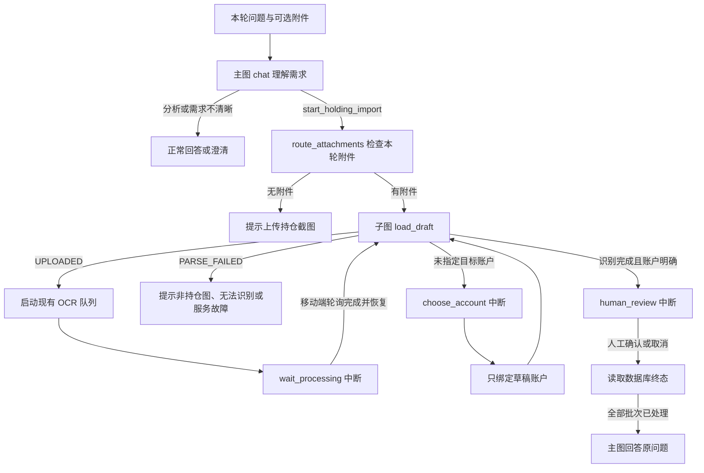

# Agent 持仓截图同步：后端与移动端

截图随本轮问题提交：选图先保存在移动端，点击发送时上传附件，再发送问题及服务端批次号。上传只创建 UPLOADED 草稿，不识别、不写正式持仓。主图先通过本轮普通模型调用理解用户需求；明确要求从图片导入、同步或更新持仓时，调用无参数的 start_holding_import，再由路由节点检查本轮附件。仅上传图片、分析截图、诊断持仓或明确不导入均不构成导入授权；需求不清晰时先询问。网页端本阶段未接入。

## 流程



识别复用现有 Taskiq worker 和本地 OCR；Redis broker 需要截图识别 worker，开发环境可用已有进程内 broker。子图没有额外聊天模型调用。等待通过 checkpoint 和 interrupt 实现，不持续占用 HTTP 连接。识别完成由移动端轮询后恢复；服务端不向离线客户端主动推送。

意图判断复用主图原有模型调用，不新增独立分类请求。识别、选账户和人工复核等待期间不轮询模型；全部完成后主图继续回答。缺图和识别失败使用固定提示，不额外调用模型。OCR 内容检查区分明显无关图、模糊或空白图、持仓列表不完整；这是启发式检查，不能保证识别所有图片类型。多图部分失败时保留有效草稿，并在复核卡片提示核对完整性。只有人工确认才更新正式持仓。

本轮明确的 holding_account_id 或自有账户名称传入子图，识别完成后跳过账户询问。缺失、含糊或否定的目标必须询问，不能根据截图文字、历史消息或第一个账户猜测。即使只有一个账户，未指定时也需要选择。

## 接口

路径以 /api/v1 为前缀，均使用当前聊天会话的 access token。

| 操作 | 接口 | 参数 / 结果 |
| --- | --- | --- |
| 保存附件 | POST /chatbot/holding-imports/screenshots | multipart files；可选 query account_id；202 返回 import_id 和 UPLOADED |
| 发送问题 | POST /chatbot/chat 或 /chatbot/chat/stream | messages、holding_import_ids、可选 holding_account_id |
| 查询识别 | GET /chatbot/holding-imports/{id} | 状态和完整草稿 |
| 恢复卡片 | GET /chatbot/pending-action | pending_action 或 null |
| 识别结束后继续 | POST /chatbot/holding-imports/{id}/continue | interrupt_id |
| 补充账户 | POST /chatbot/holding-imports/{id}/account | interrupt_id、account_id；只绑定草稿 |
| 确认 / 取消 | POST /chatbot/holding-imports/{id}/decision | interrupt_id、decision；确认必须附 review_digest，取消无需指纹 |

```json
{
  "messages": [{"role": "user", "content": "把截图持仓同步到支付宝，再分析我的持仓"}],
  "holding_import_ids": ["aaaaaaaaaaaaaaaaaaaaaaaaaaaaaaaa"]
}
```

批次号必须使用真实上传结果，后端核验用户及会话归属。原图不以 URL/base64 发给主图模型，工具只能提交批次号。沿用现有图片格式、数量及大小校验。

## 三种可恢复状态

- holding_import_processing：父图等待识别。移动端每 3 秒查批次，结束后自动 continue；识别未结束的继续请求返回 409。
- holding_import_account：识别完成但账户未指定，列出用户自己的账户。可以点选或在聊天中回复名称。没有账户时先创建，再返回选择。
- holding_import_review：展示明确目标账户、完整条目、真实中断 ID 和草稿指纹。只有独立人工确认接口会应用持仓；聊天“确认”不能批准导入。

普通响应、消息历史和流式最后一帧均可返回卡片。刷新或重连通过 pending-action 恢复，移动端本地状态和缓存按会话隔离。普通聊天仅在待选账户阶段接受账户补充，其他等待阶段返回 409。

## 复核与一致性

复核列表可以滚动查看全部行，显示金额、份额、置信度、校验问题和当前持仓金额。聊天卡片提供查看、确认及取消；修正条目仍使用现有 PATCH /holding-imports/{id}/items/{item_id}。编辑后刷新获取新指纹，旧指纹确认返回 409，不写持仓。

确认按基金覆盖选定账户的快照，截图未出现的持仓保留。持仓、IMPORT_ADJUSTMENT 调整流水和 APPLIED 状态在同一事务内提交；重复确认不会重复写入。只有 APPLIED 才能表示同步成功。

识别中、待选账户和待复核均可取消。识别结果保存前重新锁定并检查状态，迟到的成功或失败结果都不能重新激活 CANCELLED 草稿。多个批次依次复核，全部处理后父图继续，每个 ToolCall 保持一个对应 ToolMessage。

启动识别使用批次行锁去重，账户补充、继续及决策共用会话锁；并发恢复返回 409。多 API worker 部署需配置可用 Valkey/Redis，内存锁用于单进程。恢复失败或超时后先查询批次状态及 pending-action，再重试；已经应用的批次不会重复写入。

未发送成功的附件保持 UPLOADED，不启动 OCR，可通过现有取消接口清理；本阶段没有新增定时清理作业。

## 迁移与验证

迁移 f1a6c8b4d209 允许尚未绑定账户的会话截图草稿。数据库约束仍要求普通导入及 APPLIED 批次有账户。其他环境运行 APP_ENV=<环境> alembic upgrade head，然后重启后端。

父图入口：backend/app/agent/graph/agent.py 的 route_attachments；子图：backend/app/agent/graph/holding_import.py；移动端：mobile/app/(tabs)/agent.tsx。移动端类型由后端 OpenAPI 生成。

自动测试覆盖真实中断和恢复、明确及缺失账户、聊天补充账户、跨用户/会话隔离、重复及并发请求、识别失败、取消期间识别结束和多批次顺序处理。PostgreSQL 测试用回滚事务验证无目标草稿保存、账户绑定和确认写入。自动测试不使用真实用户截图或调用真实聊天模型。
