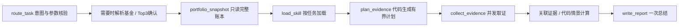

# 研究子图与移动端数据卡片

沿用项目分层：编排位于 `app/agent/graph`，契约位于 `app/schemas`，纯金融计算位于 `app/analytics`，领域服务复用异步仓储，移动端增加适配组件与 hooks。无需新增数据库表或迁移。

## 固定流程



明确基金代码、带市场前缀的股票代码、BK代码和本人组合诊断走保守规则快速路径；其他自然语言由原有chat提出start_research，服务端校验，不增加独立分类或规划模型。基金查询词必须来自本轮原文或本轮已确认对象；账户编号不能按名称猜测。已有成本、市值、可用资金不自动转为拟操作金额。

基金名称仍先走现有Top3选择，恢复后沿用原任务。股票支持明确的 `sh600519`、`sz000001`、`hk00700`、`usAAPL` 等，暂未实现仅凭股票名称的查找，不猜市场或代码。板块名称对应多个真实对象时返回前三个候选，请用户回复代码后再研究。

每类研究都先读取持仓快照，这不是持仓截图导入，不索要截图、不创建持仓。空账本和读取失败分开；未持仓基金以及公开股票、板块仍能研究。只有任务需要个人信息时，个人证据才进入报告。身份来自已认证运行时，账户由服务端校验归属。快照批量读取基金与净值，复用流水投影，不逐只查库，不把周/月历史加载进研究。全部账本行留给计算，展示裁剪不改变金额计算范围；读取时间不代表持仓市值已刷新。

| 研究意图 | 加载技能 |
| --- | --- |
| fund_research | fund-analysis |
| portfolio_diagnosis | portfolio-diagnosis |
| allocation_analysis | fund-allocation |
| sector_research | sector-analysis |
| stock_research | stock-analysis |

先加载skill，再规划工具。计划由代码按任务和深度生成，每次最多四项并发，单项25秒截止。基金常规研究读取概况、业绩指标、披露重仓和经理；深度模式增加公告。组合最多深入三只优先基金。市场、板块和事件按需取证；只使用真实BK及事件ID。最终调用无工具模型总结，保留原画像、记忆、用户模型与Langfuse链路。自然语言路由、摘要和供应商降级可能额外调用模型，不能承诺整次请求只有一次调用。

快照、已加载技能、计划、证据和金额情景为子图私有状态；父图只接收最终回答与紧凑ResearchResult。最终证据预算6500 tokens；过长正文或超过50行的持仓展示明确记录缺口，金额情景使用完整快照。计算要求全部市值有效且汇总一致。新增资金进入基金资产桶，赎回资金离开基金资产桶；不含现金、其他资产、费用、转换和未来收益。金额缺失时仍可定性分析，但不编造精确比例。所有研究均只读，不执行买卖。

股票研究并发复用报价、近一年复权日K及公司资料，只给模型紧凑指标与图表标识，不传OHLC序列。单项失败保留其他证据并公开缺口；大陆报价核验时间，港美股时区与当日新鲜度未核验。当前未接完整财报、股票个人账本、企业公告、盈利预测和目标价。板块目前只有报价，没有历史OHLC、主力资金流和行业估值。

## 人工回复与失败任务恢复

基金选择后继续原研究任务。模型直接调用 `resolve_fund_for_analysis` 时，明确的研究需求由代码结合真实确认结果恢复任务；复用本轮已确认基金，不再重新规划或搜索。单纯查询净值、经理等仍由普通聊天处理。

通用 `ask_human` 暂停以 `pending_action.kind = human_question` 返回问题及真实中断ID，刷新历史后仍可显示。用户正常输入回答即可恢复同一个中断。LangGraph通过 `GraphInterrupt` 实现暂停，所以工具追踪里的 `Interrupt(value=...)` 表示等待人工输入，并不说明模型调用失败。不能吞掉该异常或自动代替用户确认。

人工决定已保存、后续节点失败时，`GET /chatbot/pending-action` 返回独立的 `continuation`，携带原轮次ID。移动端继续按钮调用 `POST /chatbot/continue`；明确输入“继续分析”或“重试”也能恢复失败的原任务。沿checkpoint继续未完成节点，不重发选择、不重置基金、不重复已经保存的取证。节点保存前已完成的外部副作用不具备恰好一次保证。仍在等待人工输入或轮次不匹配时返回409；任务已经完成时只返回结果，不再次执行。新的实质性问题仍开启新轮次。

普通聊天和人工决策共用会话执行锁，避免并发请求覆盖确认结果。移动端异步回调及缓存失效绑定发起会话，切换会话后旧结果不会显示到新会话。流式终止帧明确清除已完成的待确认卡片。

## 移动端显示

现有fund-chart / fund-holdings继续复用原组件。新增 `research-chart` 完整JSON代码块只允许以下引用：

```json
{"schema_version":1,"type":"stock_price","symbol":"sh600519"}
```

```json
{"schema_version":1,"type":"sector_quote","sector_code":"BK1234","sector_type":"industry"}
```

```json
{"schema_version":1,"type":"fund_allocation","fund_code":"000001","account_id":null,"action":"increase","amount":200}
```

引用由取证/金额计算代码签发。最终回答移除模型改写的引用，并补上遗漏的真实卡片。流式文字正常显示，新的引用代码块及后缀等服务端校验完成后发送，最终流文本与保存的历史一致。移动端不执行代码，不接受URL、序列、身份字段、未知版本、额外字段或未闭合代码块。

- 股票卡片复用未改动的MarketChart及原行情hooks，直接请求 `/markets/{symbol}/quote` 和 `/history`，可切换1/3/6/12个月。
- 板块卡片按真实BK代码与类型读取鉴权 `GET /sectors/market`，显示报价时间、缺失值、延迟和来源警告；历史走势图预留模块明确显示尚未接入，不画假数据。
- 操作卡片请求鉴权 `GET /portfolio/allocation-preview`，按当前登录用户账本重新计算，展示操作前后基金占比与金额。缓存键包含用户、基金、账户、方向和金额，持仓变更沿用portfolio前缀失效；服务端校验账户归属，不写交易。

图表拉取时间可能晚于报告，卡片会说明。基金详情页、NavChart和MarketChart行为保持原样。自动化测试使用模拟行情和模型；真实供应商回答质量、实际延迟和真机交互仍需联调验证。
