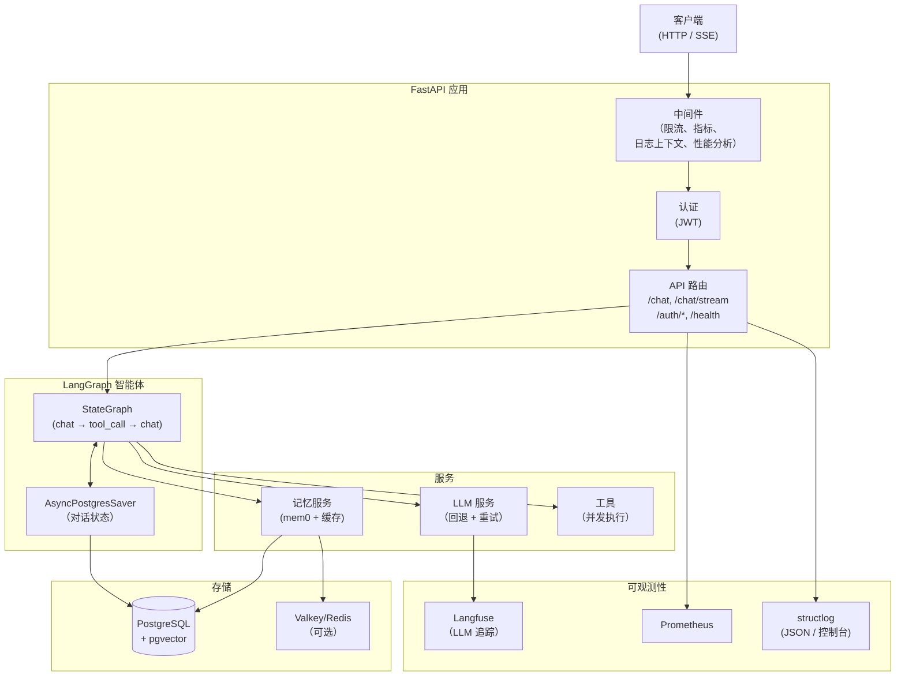
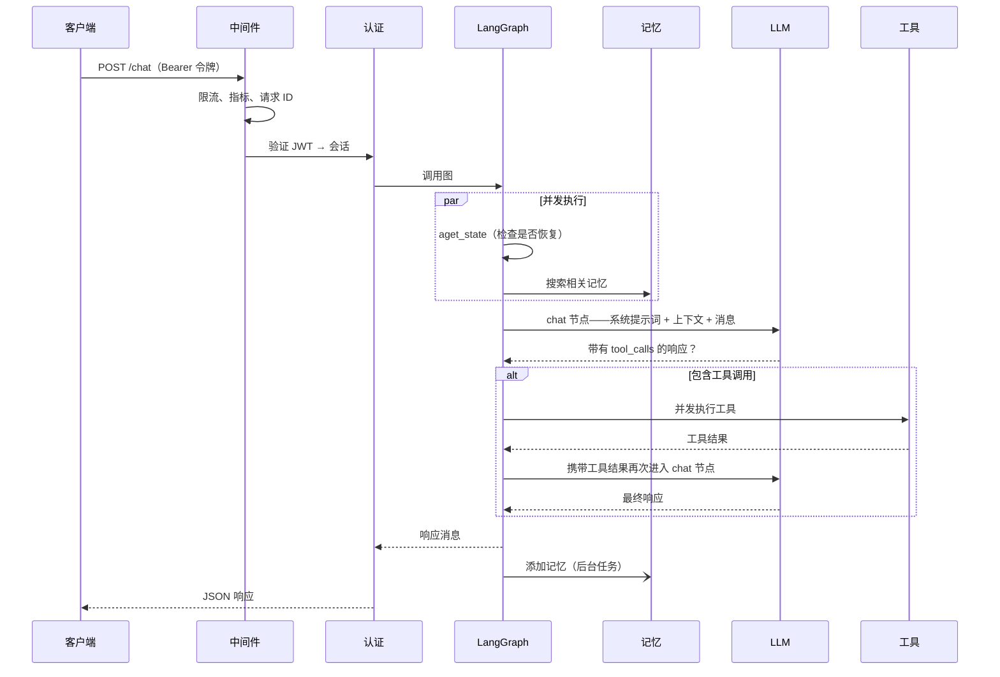
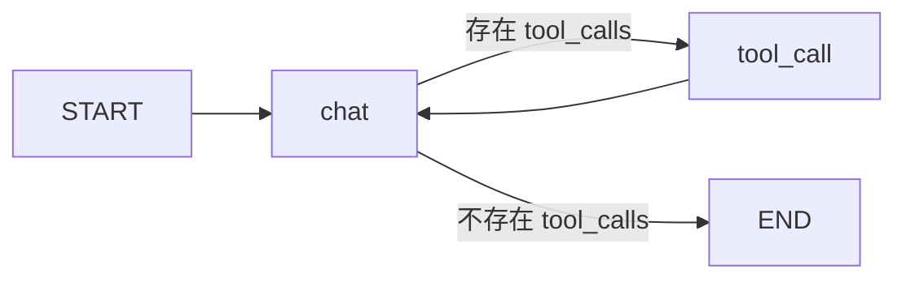

# 架构

## 系统概览

## 请求生命周期

## 智能体图

智能体是一个双节点 `StateGraph`：

- **`chat` 节点**——构建系统提示词，调用 LLM，并返回一个路由至 `tool_call` 或 `END` 的 `Command`
- **`tool_call` 节点**——并发执行所有工具调用，并将结果传回 `chat`
- **检查点存储器**——`AsyncPostgresSaver` 按 `thread_id`（会话）持久化完整的 `GraphState`，从而支持中断后恢复和多轮记忆

## 关键设计决策

**记忆搜索与状态检查并发运行。** 对每个非恢复请求，`aget_state`（检查中断）和 `memory.search`（获取相关记忆）通过 `asyncio.gather` 并行运行，每个请求可节省 200–500 毫秒。

**工具调用并发执行。** 当 LLM 在一次响应中返回多个工具调用时，它们都会通过 `asyncio.gather` 并行执行。

**系统提示词在模块加载时缓存。** `system.md` 只在启动时读取一次。每个请求的开销仅是使用用户姓名、当前日期时间和检索到的记忆执行 `.format()`，不发生文件 I/O。

**LLM 回退受总时限约束。** 每次调用以 300 秒总预算覆盖重试和回退；首段进度等待 120 秒，出现有效流式进度后按 60 秒无进展时限控制。部分输出不会通过自动重试或回退再次播放。配置见 [LLM 服务](llm-service.md)。

**用户名通过会话传递，而不是随请求查询数据库。** 创建会话时，用户显示名会复制到 `Session.username`。聊天请求直接从已加载的会话对象读取该值，不会产生额外查询。

**生成会话标题不会增加响应延迟。** 对于未命名会话的第一条消息，API 会以占位名称（用户消息的截断版本）原子地认领该会话，然后启动后台 `asyncio.Task`，调用快速 nano 模型并获取结构化输出。主聊天响应会立即返回，标题生成则并发进行。Postgres 中的原子操作 `UPDATE … WHERE name = ''` 可确保即使存在并发请求，也只有一个工作进程能够成功认领。

## 组件职责

| 组件 | 文件 | 职责 |
|---|---|---|
| LangGraph 智能体 | `app/core/langgraph/graph.py` | 编排对话循环 |
| LLM 服务 | `app/services/llm/` | 模型注册、重试、循环回退和结构化输出 |
| 记忆服务 | `app/services/memory.py` | mem0 语义记忆与缓存 |
| 会话命名 | `app/services/session_naming.py` | 在后台为新会话生成 LLM 标题 |
| 数据库服务 | `app/services/database.py` | 用户/会话 CRUD |
| 缓存服务 | `app/core/cache.py` | Valkey/Redis，并提供内存回退 |
| 中间件 | `app/core/middleware.py` | 指标、日志上下文和性能分析 |
| 认证 | `app/api/v1/auth.py` | JWT 创建和会话管理 |
