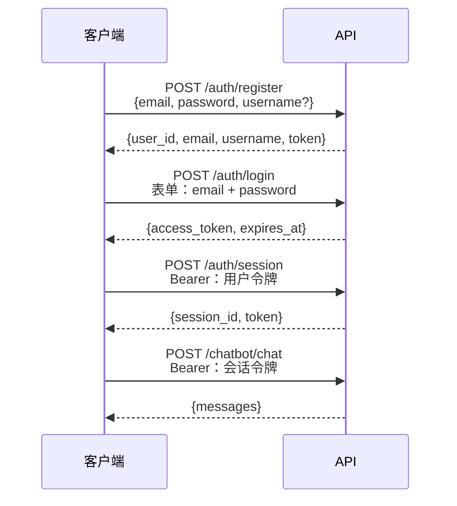

# 身份认证

## 流程



API 使用**两种令牌作用域**：

- **用户令牌**——注册或登录时签发，用于标识用户，以及创建和列出会话。
- **会话令牌**——为每个对话会话签发。所有聊天端点都要求提供此令牌，并且它仅对单个 `session_id` 有效。

两者都是使用 HS256 签名的 JWT，过期时间可通过 `JWT_ACCESS_TOKEN_EXPIRE_DAYS` 配置。

---

## 端点

### `POST /api/v1/auth/register`

创建新账户。

```json
{
  "email": "you@example.com",
  "password": "Secret123!",  // pragma: allowlist secret
  "username": "you"
}
```

密码要求：至少 8 个字符，且包含大写字母、小写字母、数字和特殊字符。

`username` 为可选项。提供后，它会传入智能体的系统提示词，让 LLM 知道用户的姓名。

---

### `POST /api/v1/auth/login`

使用凭据换取用户令牌。该端点使用 OAuth2 密码授权表单字段。

```bash
curl -X POST /api/v1/auth/login \
  -F "email=you@example.com" \
  -F "password=Secret123!" \
  -F "grant_type=password"
```

返回 `access_token` 和 `expires_at`。

---

### `POST /api/v1/auth/session`

创建新的聊天会话。需要有效的用户令牌。

```bash
curl -X POST /api/v1/auth/session \
  -H "Authorization: Bearer <用户令牌>"
```

返回 `session_id` 和仅限该会话使用的 `token`。后续所有聊天请求都应使用此会话令牌。

---

### `PATCH /api/v1/auth/session/{session_id}/name`

重命名会话。

```bash
curl -X PATCH /api/v1/auth/session/{session_id}/name \
  -H "Authorization: Bearer <会话令牌>" \
  -F "name=我的研究会话"
```

---

### `DELETE /api/v1/auth/session/{session_id}`

删除会话及其聊天历史记录。

---

### `GET /api/v1/auth/sessions`

列出已认证用户的所有会话。需要用户令牌。

---

## 安全说明

- 密码在存储前使用 bcrypt 进行哈希处理，绝不会持久化明文密码。
- JWT 包含 `jti`（JWT ID）声明，以确保令牌唯一性。
- 所有字符串输入在使用前都会经过清理。
- 限流可保护注册端点（10 次/小时）和登录端点（20 次/分钟），防止暴力破解。
- 在生产环境中，应将 `JWT_SECRET_KEY` 设置为较长的随机字符串，长度至少为 32 个字符。
