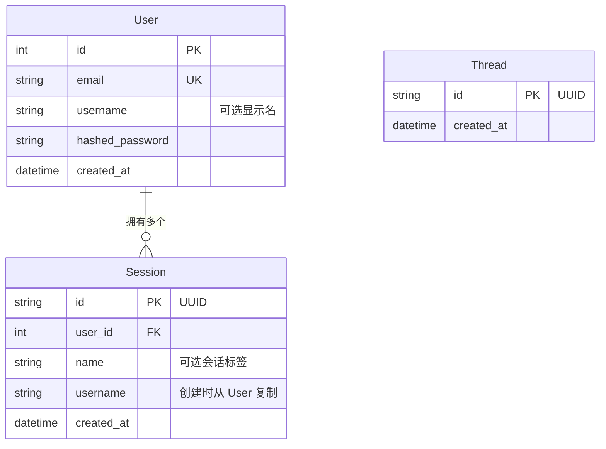

# 数据库与迁移

## 数据库结构



**User**——每个账户对应一个用户。电子邮箱唯一。`username` 为可选字段，用于对系统提示词进行个性化。

**Session**——每次对话对应一个会话。一个用户可以拥有多个会话。创建会话时会将 `username` 从 `User` 反规范化复制过来，因此聊天请求无需额外查询数据库。会话 JWT 限定了所有聊天请求的作用域。

**Thread**——与 LangGraph 的 `AsyncPostgresSaver` 检查点线程对应，用于追踪应用上下文中存在的线程。

LangGraph 检查点存储器还会创建自己的表（`checkpoints`、`checkpoint_blobs`、`checkpoint_writes`）。这些表由 LangGraph 自行管理，而非 Alembic。

pgvector 会创建一个由 mem0 管理的 `longterm_memory` 集合表，该表同样不由 Alembic 管理。

---

## 使用 Alembic 迁移

所有数据库结构变更都通过 Alembic 管理。应用启动时不再调用 `create_all()`，数据库结构完全由 Alembic 负责。

### 初始设置（全新数据库）

```bash
make migrate              # 将所有迁移应用到数据库
```

### 模型变更后创建迁移

```bash
# 1. 编辑 SQLModel 模型（app/models/）
# 2. 生成迁移
make migration MSG="add phone number to user"

# 3. 检查 alembic/versions/ 中生成的文件
# 4. 应用迁移
make migrate
```

### 其他命令

```bash
make migrate-downgrade    # 回滚上一次迁移
make migrate-history      # 显示完整迁移历史
```

Alembic 通过 `app/core/config.py` 从 `.env` 文件读取数据库凭据。运行迁移前，请确保设置了正确的 `APP_ENV`。

### 自动生成的工作原理

`env.py` 会导入所有 SQLModel 模型以注册其元数据，然后调用 `alembic revision --autogenerate`。Alembic 会比较当前数据库结构与模型之间的差异，并生成升级和降级函数。

外部表（LangGraph 检查点存储器、mem0、pgvector）通过 `alembic/env.py` 中的 `include_object` 排除，因此 Alembic 绝不会修改它们。

### 添加新模型

1. 创建 `app/models/your_model.py`
2. 在 `alembic/env.py` 中与其他模型一起导入它
3. 运行 `make migration MSG="add your_model table"`

---

## 向全新数据库添加 pgvector

运行迁移前必须启用 pgvector：

```sql
CREATE EXTENSION IF NOT EXISTS vector;
```

对于外部数据库（例如 Supabase），请通过控制面板或 SQL 编辑器启用该扩展。
