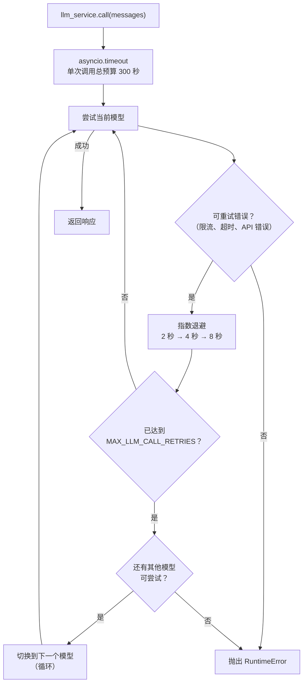

# LLM 服务

## 概览

LLM 服务（`app/services/llm/`）负责所有语言模型调用，并提供自动重试、循环模型回退和总超时预算。智能体代码只需调用 `llm_service.call(messages)`，其余工作全部由该服务处理。

该包包含以下模块：

- `app/services/llm/registry.py`——`LLMRegistry`：定义可用模型
- `app/services/llm/service.py`——`LLMService`：调用逻辑、重试、回退和结构化输出
- `app/services/llm/timeouts.py`——单次调用的流式进度与超时分类

## 模型注册表

模型按优先级顺序定义在 `LLMRegistry.LLMS` 中：

| 名称 | 模型 | 说明 |
| -------------- | ------------ | -------------------------------------- |
| `gpt-5-mini` | gpt-5-mini | 默认模型，推理强度较低。 |
| `gpt-5.4` | gpt-5 | 中等推理强度。 |
| `gpt-5.4-nano` | gpt-5.4-nano | 速度快，推理强度较低。 |
| `gpt-5` | gpt-5 | 完整模型，采样参数针对生产环境调优。 |

在 `.env` 中设置 `DEFAULT_LLM_MODEL` 以选择起始模型。

如需添加或更改模型，请编辑 `app/services/llm/registry.py` 中的 `LLMRegistry.LLMS`。

## 重试与回退行为



**重试配置**（每个模型）：

- 最大尝试次数：`MAX_LLM_CALL_RETRIES`（默认值：3）
- 等待策略：指数退避，最短 2 秒，最长 10 秒
- 对以下异常进行重试：`RateLimitError`、`APITimeoutError`、`APIError`

**超时策略**以每次 `llm_service.call` 为单位，包含该调用的重试和模型回退，不是整轮多步骤 Agent 的总时限：

| 环境变量 | 默认值 | 行为 |
| --- | --- | --- |
| `FUND_LLM_TIMEOUT_SECONDS` | `120` | 等待首段有效进度，同时用于 HTTP 请求超时；`FUND_LLM_REQUEST_TIMEOUT_SECONDS` 可优先覆盖。 |
| `FUND_LLM_STREAM_IDLE_TIMEOUT_SECONDS` | `60` | 输出开始后，正文、推理或工具参数的最大进度间隔；空心跳帧不延长时限。 |
| `FUND_LLM_TOTAL_TIMEOUT_SECONDS` | `300` | 重试与模型回退共用的硬上限，持续输出也不能无限延期；优先于旧变量 `LLM_TOTAL_TIMEOUT`。 |

进度回调保留 LangGraph 流式处理和 Langfuse 追踪。首段应用级等待超时后直接切换模型，不在同一个模型重复等待；尚无输出的其他可重试上游错误仍由 Tenacity 指数退避处理。默认关闭 SDK 内置重试，避免重试叠加。只要已产生正文、推理或工具参数，发生中断就停止本次调用，不自动重试或切换模型，避免把两份回答拼在一起。这里保守地包括客户端未必能看到的推理内容。

日志记录实际尝试模型、尝试次数、首段耗时、最后进度距今时间、分片数和正文长度，不保存回答正文。成功调用还记录供应商提供的 token 用量和结束原因。修改环境配置后需重启后端。

**回退顺序**：按照 `LLMRegistry.LLMS` 循环遍历。到达最后一个模型后，会回到第一个模型，并在完成一整轮后停止。

## 聊天输入与输出边界

`ChatRequest` 只接受用户角色的 `ChatInputMessage`，正文保持 1–3000 字符，并保留脚本标签与空字节校验。服务端内部、回答及历史消息使用 `Message`，不设置字符数上限，也不套用仅面向输入的正文校验。生成长度由模型 token 预算控制；响应序列化和历史读取原样保留已经保存的全文，包括图表代码块。已有长消息检查点不需要改写或迁移。流式分片同样返回完整正文。

## 工具

工具在启动时绑定到 LLM：

```python
llm_service.bind_tools(tools)
```

在回退期间切换模型时，工具会自动重新绑定到新模型。

## 结构化输出

将 Pydantic 模型作为 `response_format` 传入，即可返回经过验证的模型实例，而非原始 `BaseMessage`：

```python
from app.schemas.my_schema import MySchema

result: MySchema = await llm_service.call(
    messages,
    model_name="gpt-5.4-nano",   # 可选——省略时使用当前默认模型
    response_format=MySchema,
    temperature=0.2,
)
```

该服务会在已解析的模型上链接 `.with_structured_output(schema)`，并在每次回退尝试时重新包装，因此重试和模型切换都能透明地工作。

## 添加新模型

```python
# app/services/llm/registry.py — LLMRegistry.LLMS
{
    "name": "gpt-5.4",
    "llm": ChatOpenAI(
        model="gpt-5.4",
        api_key=settings.OPENAI_API_KEY,
        max_tokens=settings.MAX_TOKENS,
    ),
},
```

可以将其添加到列表中的任意位置。回退顺序与列表顺序一致。
